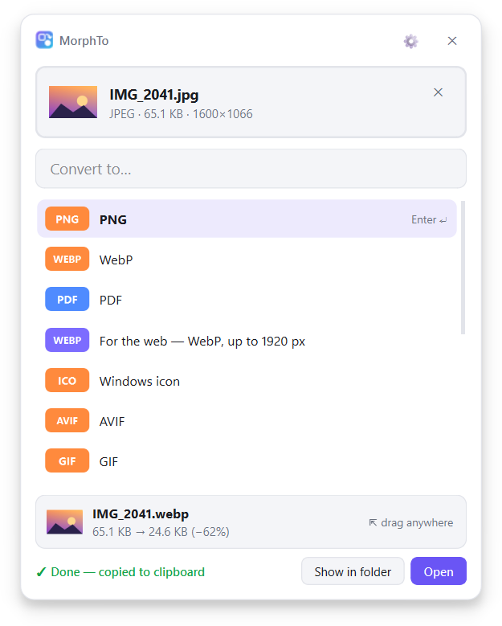
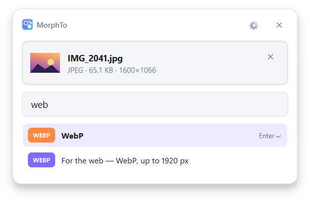
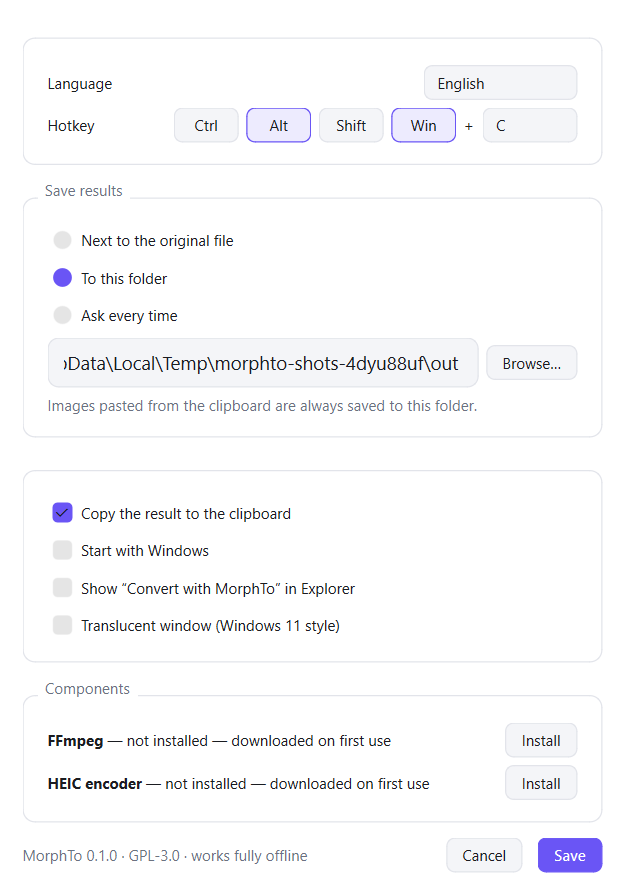

<div align="center">


# MorphTo

**Press a hotkey, paste, pick a format. Done.**

A fast, lightweight file converter for Windows that lives in the tray.
Images, audio, video, documents and presentations, fully offline.

[**⬇ Download for Windows**](https://github.com/rearzty/MorphTo/releases/latest/download/MorphTo-setup.exe)
&nbsp;·&nbsp; [Portable zip](https://github.com/rearzty/MorphTo/releases/latest)
&nbsp;·&nbsp; [Русский](README.ru.md)

Windows 10 (1809+) and 11 · 64-bit · ~22 MB download · free and open source (GPL-3.0)

<picture>
  <source media="(prefers-color-scheme: dark)" srcset="docs/images/en/done-dark.png">
  
</picture>

</div>

## How it works

1. Press <kbd>Win</kbd>+<kbd>Alt</kbd>+<kbd>C</kbd> anywhere. A small popup appears.
2. Paste a file or a screenshot with <kbd>Ctrl</kbd>+<kbd>V</kbd>, drop files onto it, or click to browse.
3. Type a format (`jpg`, `mp4`, `pdf`…) and press <kbd>Enter</kbd>.

The result is saved and copied to the clipboard, ready to paste into a chat, an email or a folder.
You can also drag it straight out of the popup.

## Features

- **Keyboard-first.** Hotkey, <kbd>Ctrl</kbd>+<kbd>V</kbd>, a few letters, <kbd>Enter</kbd>. No menus.
- **Clipboard in, clipboard out.** Convert a screenshot without saving it first; paste the result anywhere.
- **Smart suggestions.** For an iPhone photo (HEIC) JPG comes first; the formats you use most rise to the top.
- **Presets for everyday tasks.** Compress a video for Discord (under 10 MB), WebP for the web, a Windows icon,
  a smaller photo or MP3.
- **Batch.** Select many files at once.
- **Explorer integration.** “Convert with MorphTo” in the right-click menu (optional).
- **Before → after.** See how much smaller (or bigger) the file became.
- **Stays visible while working.** Progress on the taskbar button and a ring on the tray icon.
- **Fast.** Container changes (MKV ↔ MP4 ↔ MOV) copy the streams instead of re-encoding, so they take a second.
- **Native look.** Light and dark themes, acrylic background on Windows 11.
- **13 languages.** English, Русский, Українська, Deutsch, Français, Español, Português, Italiano, Polski,
  Türkçe, 简体中文, 日本語, 한국어.
- **Command line** for scripts and automation.

<table>
<tr>
<td><picture><source media="(prefers-color-scheme: dark)" srcset="docs/images/en/search-dark.png"></picture></td>
<td><picture><source media="(prefers-color-scheme: dark)" srcset="docs/images/en/settings-dark.png"></picture></td>
</tr>
</table>

## Supported formats

| Category | Read | Write |
|---|---|---|
| Images | PNG, JPEG, WebP, AVIF, HEIC/HEIF, GIF (animated), BMP, TIFF, ICO, ICNS, TGA, JPEG 2000, PSD | all of these except PSD, plus PDF |
| Audio | MP3, WAV, FLAC, OGG, Opus, M4A, AAC, WMA, AIFF | the same |
| Video | MP4, MKV, WebM, MOV, AVI, WMV, FLV, MPEG, TS, 3GP, OGV, GIF | MP4, MKV, WebM, MOV, AVI, WMV, FLV, GIF, and any audio format |
| Documents | DOCX, DOC, ODT, RTF, TXT, PDF | PDF, DOCX, DOC, ODT, RTF, TXT; pages as PNG, JPEG, WebP, TIFF |
| Spreadsheets | XLSX, XLS, ODS, CSV | PDF, XLSX, XLS, ODS, CSV; pages as images |
| Presentations | PPTX, PPT, ODP | PDF, PPTX, PPT, ODP; slides as images |

A PDF (or a document, a spreadsheet, slides) with several pages turns into a folder of images,
`page-01.png`, `page-02.png`…, or into one multi-page TIFF. PDF to TXT extracts the text.

More categories (archives, fonts, ebooks) are planned.

### Optional components

To keep the app small, some components are downloaded only the first time you need them. MorphTo asks first,
then downloads, verifies the checksum and continues the conversion.

| Component | Needed for | Download |
|---|---|---|
| FFmpeg (www.gyan.dev build) | audio and video | ~34 MB |
| HEIC encoder (pillow-heif from PyPI) | saving *to* HEIC (reading HEIC works out of the box) | ~7 MB |
| LibreOffice (libreoffice.org) | Word, Excel, PowerPoint and OpenDocument files | ~360 MB, or none if it is already installed |

PDF files need nothing extra. If Microsoft Office is installed, MorphTo uses it for Word, Excel and PowerPoint
to PDF (the layout is exactly as in Office), so LibreOffice is only needed for the other conversions.
The downloaded LibreOffice is unpacked into MorphTo's own folder: nothing is installed into Windows.

You can also install or remove them in Settings → Components, or with `morphto engines install ffmpeg`.

## Install

Download [`MorphTo-setup.exe`](https://github.com/rearzty/MorphTo/releases/latest/download/MorphTo-setup.exe)
and run it. No administrator rights are needed: MorphTo installs for your user only, in
`%LOCALAPPDATA%\Programs\MorphTo`. On first start it shows the hotkey and lets you turn on
“Start with Windows” and the Explorer menu.

Prefer no installer? Take the portable zip from the [releases page](https://github.com/rearzty/MorphTo/releases/latest),
unpack it anywhere and run `MorphTo.exe`.

> **“Windows protected your PC”?** MorphTo is new and not code-signed yet, so Microsoft SmartScreen warns about it.
> Click **More info → Run anyway**. Every release lists SHA-256 checksums in `SHA256SUMS.txt`, and the whole
> build runs on GitHub Actions from the source in this repository.

## Command line

The installer can add `morphto` to your PATH:

```text
morphto convert photo.heic -t jpg                 # next to the original
morphto convert *.png -t webp -q 80 -o out\       # batch into a folder
morphto convert clip.mov -t discord               # preset: MP4 under 10 MB
morphto convert talk.mp4 -t mp3                   # extract the audio
morphto formats                                   # every format
morphto formats photo.heic                        # what this file can become
morphto presets                                   # all presets
morphto engines                                   # optional components
```

`morphto` waits for the result and returns a proper exit code, so it works in scripts.

## Privacy

Everything happens on your computer. MorphTo has no accounts and no telemetry. It goes online only to:

- download an optional component when you agree to it (from `www.gyan.dev` for FFmpeg, `pypi.org`
  for the HEIC encoder and `download.documentfoundation.org` for LibreOffice);
- check for a new version: one request to the GitHub API at start and once a day, with nothing about you or
  your files in it. Turn it off in Settings.

When a new version is out, an “Update” button appears in the popup and in the tray menu. It downloads the
installer from GitHub Releases, verifies its checksum and updates MorphTo in place, keeping your settings.
The portable version opens the download page instead.

## FAQ

**The hotkey doesn't work.** Another program may already use <kbd>Win</kbd>+<kbd>Alt</kbd>+<kbd>C</kbd>;
MorphTo then shows a notification. Pick another shortcut in Settings (click the tray icon → ⚙).

**Where are the converted files?** Next to the original by default. You can switch to a fixed folder or to
“Ask every time” in Settings. Images pasted from the clipboard go to `Downloads\MorphTo`.

**How do I close the popup?** <kbd>Esc</kbd>, ✕, the hotkey again, or the tray icon. After a conversion it
closes by itself after a few seconds.

**It crashed.** Please [open an issue](https://github.com/rearzty/MorphTo/issues/new/choose) and attach
`%LOCALAPPDATA%\MorphTo\crash.log`.

**How do I uninstall it?** Windows Settings → Apps → MorphTo. The uninstaller removes the autostart entry and the
Explorer menu, and asks whether to delete your settings and downloaded components.

## Building from source

Requires Python 3.12+ (developed on 3.14).

```bash
python -m venv .venv
.venv\Scripts\activate
pip install -e ".[dev]"
pytest
morphto gui                                       # run the tray app from source
```

Building the Windows app:

```bash
pip install pyinstaller ziglang   # ziglang only compiles the tiny morphto.com console front-end
python packaging/build.py         # -> dist\MorphTo\
dist\MorphTo\MorphTo.exe --self-test some-photo.png   # drives the real GUI end to end
```

Releases are built by GitHub Actions when a `v*` tag is pushed (see `.github/workflows/release.yml`); the installer
script is `packaging/installer.iss` (Inno Setup 6).

<details>
<summary>Project layout</summary>

```text
src/morphto/
  core/         formats, signature detection, converter graph, targets and presets
  converters/   Pillow (images), FFmpeg (audio/video), HEIC encoder, PDFium (PDF), LibreOffice / MS Office
  engines.py    on-demand download of optional components
  gui/          tray app, popup, settings, welcome, taskbar progress, Windows 11 effects
  platform/     Windows integration: hotkey, clipboard, single instance, autostart, Explorer menu
  i18n/         translations (one JSON file per language)
  cli.py        command line
packaging/      app and installer build, README screenshots
```

</details>

**Adding a converter:** subclass `morphto.core.registry.Converter`, declare the format pairs in `pairs()`,
implement `convert()` and register it in `morphto/converters/__init__.py`. Multi-step conversions are found
automatically through the format graph.

**Adding a language:** copy `src/morphto/i18n/locales/en.json`, translate the values and add the code to
`LANGUAGES` in `src/morphto/i18n/__init__.py`.

Bug reports, ideas and pull requests are welcome.

## License

MorphTo is free software under the [GNU General Public License v3.0 or later](LICENSE).
Copyright © 2026 rearzty.

The app bundles Qt / PySide6 (LGPL-3.0), Python (PSF License), Pillow (MIT-CMU), pi-heif (BSD-3-Clause,
with LGPL-3.0 libheif and libde265) and pypdfium2 / PDFium (BSD-3-Clause, Apache-2.0). The full texts ship with the app in `THIRD-PARTY-NOTICES.txt`.
FFmpeg (GPL) and LibreOffice (MPL-2.0) are downloaded separately.
