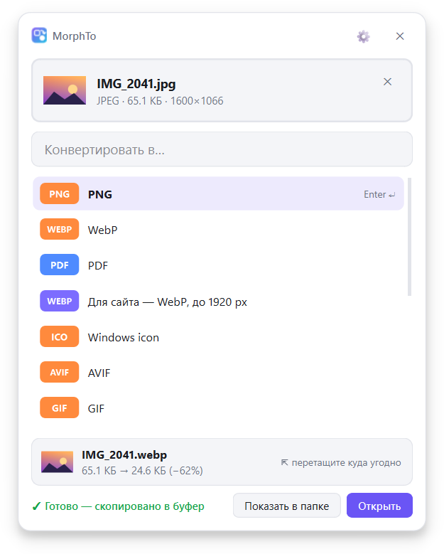
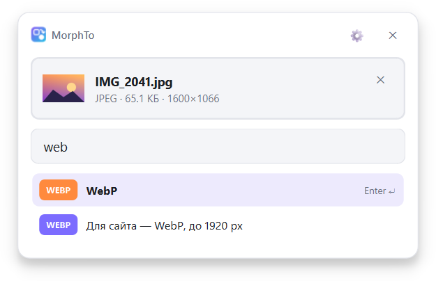
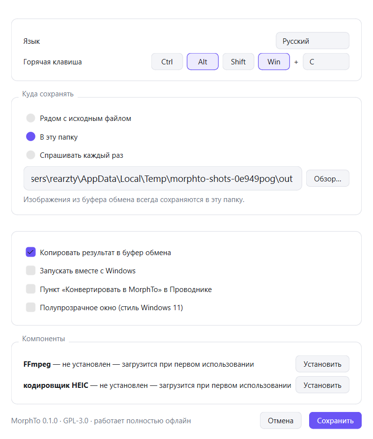

<div align="center">


# MorphTo

**Нажал сочетание, вставил, выбрал формат. Готово.**

Быстрый и лёгкий конвертер файлов для Windows, который живёт в трее.
Картинки, аудио, видео, документы и презентации, полностью офлайн.

[**⬇ Скачать для Windows**](https://github.com/rearzty/MorphTo/releases/latest/download/MorphTo-setup.exe)
&nbsp;·&nbsp; [Portable-архив](https://github.com/rearzty/MorphTo/releases/latest)
&nbsp;·&nbsp; [English](README.md)

Windows 10 (1809+) и 11 · 64 бита · ~22 МБ · бесплатно и с открытым кодом (GPL-3.0)

<picture>
  <source media="(prefers-color-scheme: dark)" srcset="docs/images/ru/done-dark.png">
  
</picture>

</div>

## Как это работает

1. Нажмите <kbd>Win</kbd>+<kbd>Alt</kbd>+<kbd>C</kbd> в любом месте. Появится небольшое окно.
2. Вставьте файл или скриншот через <kbd>Ctrl</kbd>+<kbd>V</kbd>, перетащите файлы в окно или выберите их кликом.
3. Введите формат (`jpg`, `mp4`, `pdf`…) и нажмите <kbd>Enter</kbd>.

Результат сохраняется и копируется в буфер обмена, его сразу можно вставить в чат, письмо или папку.
А можно просто перетащить его прямо из окна.

## Возможности

- **Всё с клавиатуры.** Сочетание, <kbd>Ctrl</kbd>+<kbd>V</kbd>, пара букв, <kbd>Enter</kbd>. Никаких меню.
- **Из буфера и в буфер.** Скриншот можно сконвертировать, не сохраняя; результат вставляется куда угодно.
- **Умные подсказки.** Для фото с iPhone (HEIC) первым идёт JPG, а форматы, которыми вы пользуетесь чаще, поднимаются наверх.
- **Пресеты для типичных задач.** Сжать видео для Discord (до 10 МБ), WebP для сайта, иконка Windows,
  облегчённое фото или MP3.
- **Пакетная обработка.** Можно выбрать сразу много файлов.
- **Пункт в меню Проводника.** «Конвертировать в MorphTo» по правому клику (по желанию).
- **До → после.** Сразу видно, насколько уменьшился (или вырос) файл.
- **Видно, что идёт работа.** Прогресс на кнопке панели задач и кольцо на значке в трее.
- **Быстро.** Смена контейнера (MKV ↔ MP4 ↔ MOV) копирует потоки без перекодирования и занимает секунду.
- **Родной вид.** Светлая и тёмная тема, акриловый фон на Windows 11.
- **13 языков.** English, Русский, Українська, Deutsch, Français, Español, Português, Italiano, Polski,
  Türkçe, 简体中文, 日本語, 한국어.
- **Командная строка** для скриптов и автоматизации.

<table>
<tr>
<td><picture><source media="(prefers-color-scheme: dark)" srcset="docs/images/ru/search-dark.png"></picture></td>
<td><picture><source media="(prefers-color-scheme: dark)" srcset="docs/images/ru/settings-dark.png"></picture></td>
</tr>
</table>

## Поддерживаемые форматы

| Категория | Чтение | Запись |
|---|---|---|
| Изображения | PNG, JPEG, WebP, AVIF, HEIC/HEIF, GIF (анимированный), BMP, TIFF, ICO, ICNS, TGA, JPEG 2000, PSD | все, кроме PSD, плюс PDF |
| Аудио | MP3, WAV, FLAC, OGG, Opus, M4A, AAC, WMA, AIFF | те же |
| Видео | MP4, MKV, WebM, MOV, AVI, WMV, FLV, MPEG, TS, 3GP, OGV, GIF | MP4, MKV, WebM, MOV, AVI, WMV, FLV, GIF и любой аудиоформат |
| Документы | DOCX, DOC, ODT, RTF, TXT, PDF | PDF, DOCX, DOC, ODT, RTF, TXT; страницы в PNG, JPEG, WebP, TIFF |
| Таблицы | XLSX, XLS, ODS, CSV | PDF, XLSX, XLS, ODS, CSV; страницы картинками |
| Презентации | PPTX, PPT, ODP | PDF, PPTX, PPT, ODP; слайды картинками |

Многостраничный PDF (или документ, таблица, презентация) превращается в папку с картинками
`page-01.png`, `page-02.png`… или в один многостраничный TIFF. PDF в TXT извлекает текст.

В планах: архивы, шрифты, электронные книги.

### Дополнительные компоненты

Чтобы приложение оставалось лёгким, некоторые компоненты скачиваются только тогда, когда впервые понадобятся.
MorphTo сначала спрашивает, затем скачивает, проверяет контрольную сумму и продолжает конвертацию.

| Компонент | Зачем | Размер |
|---|---|---|
| FFmpeg (сборка www.gyan.dev) | аудио и видео | ~34 МБ |
| Кодировщик HEIC (pillow-heif с PyPI) | сохранение *в* HEIC (чтение HEIC работает сразу) | ~7 МБ |
| LibreOffice (libreoffice.org) | файлы Word, Excel, PowerPoint и OpenDocument | ~360 МБ или ничего, если он уже установлен |

Для PDF ничего докачивать не нужно. Если установлен Microsoft Office, MorphTo использует его для перевода
Word, Excel и PowerPoint в PDF (вёрстка точно как в Office), а LibreOffice нужен только для остальных
конвертаций. Скачанный LibreOffice распаковывается в папку MorphTo: в Windows ничего не устанавливается.

Установить или удалить их можно и вручную: Настройки → Компоненты или `morphto engines install ffmpeg`.

## Установка

Скачайте [`MorphTo-setup.exe`](https://github.com/rearzty/MorphTo/releases/latest/download/MorphTo-setup.exe)
и запустите. Права администратора не нужны: MorphTo ставится только для вашего пользователя, в
`%LOCALAPPDATA%\Programs\MorphTo`. При первом запуске он покажет сочетание клавиш и предложит включить
автозапуск и пункт в меню Проводника.

Без установщика: возьмите portable-архив на [странице релизов](https://github.com/rearzty/MorphTo/releases/latest),
распакуйте куда угодно и запустите `MorphTo.exe`.

> **«Система Windows защитила ваш компьютер»?** MorphTo новый и пока не подписан цифровой подписью, поэтому
> SmartScreen предупреждает о нём. Нажмите **Подробнее → Выполнить в любом случае**. К каждому релизу приложены
> контрольные суммы SHA-256 (`SHA256SUMS.txt`), а сама сборка выполняется в GitHub Actions из кода этого репозитория.

## Командная строка

Установщик может добавить команду `morphto` в PATH:

```text
morphto convert photo.heic -t jpg                 # рядом с оригиналом
morphto convert *.png -t webp -q 80 -o out\       # пачкой в папку
morphto convert clip.mov -t discord               # пресет: MP4 до 10 МБ
morphto convert talk.mp4 -t mp3                   # вытащить звук
morphto formats                                   # все форматы
morphto formats photo.heic                        # во что можно превратить файл
morphto presets                                   # все пресеты
morphto engines                                   # дополнительные компоненты
```

`morphto` дожидается результата и возвращает код завершения, так что подходит для скриптов.

## Приватность

Всё происходит на вашем компьютере. Никаких аккаунтов, телеметрии и проверок обновлений. В интернет MorphTo
выходит только для загрузки дополнительного компонента, когда вы на это согласились (`www.gyan.dev` для FFmpeg,
`pypi.org` для кодировщика HEIC и `download.documentfoundation.org` для LibreOffice).

## Вопросы и ответы

**Не работает сочетание клавиш.** Возможно, <kbd>Win</kbd>+<kbd>Alt</kbd>+<kbd>C</kbd> уже занято другой программой,
MorphTo тогда покажет уведомление. Выберите другое сочетание в настройках (клик по значку в трее → ⚙).

**Где сконвертированные файлы?** По умолчанию рядом с оригиналом. В настройках можно выбрать отдельную папку
или «Спрашивать каждый раз». Изображения из буфера обмена сохраняются в `Загрузки\MorphTo`.

**Как закрыть окно?** <kbd>Esc</kbd>, ✕, повторное нажатие сочетания или значок в трее. После конвертации
окно закрывается само через несколько секунд.

**Программа упала.** Пожалуйста, [создайте issue](https://github.com/rearzty/MorphTo/issues/new/choose) и приложите
файл `%LOCALAPPDATA%\MorphTo\crash.log`.

**Как удалить?** Параметры Windows → Приложения → MorphTo. Деинсталлятор уберёт автозапуск и пункт из меню
Проводника и спросит, удалять ли настройки и загруженные компоненты.

## Сборка из исходников

Нужен Python 3.12+ (разрабатывается на 3.14).

```bash
python -m venv .venv
.venv\Scripts\activate
pip install -e ".[dev]"
pytest
morphto gui                                       # запустить приложение из исходников
```

Сборка приложения для Windows:

```bash
pip install pyinstaller ziglang   # ziglang нужен только для маленькой консольной обёртки morphto.com
python packaging/build.py         # -> dist\MorphTo\
dist\MorphTo\MorphTo.exe --self-test some-photo.png   # прогоняет настоящий интерфейс от начала до конца
```

Релизы собирает GitHub Actions при пуше тега `v*` (`.github/workflows/release.yml`); скрипт установщика —
`packaging/installer.iss` (Inno Setup 6).

Сообщения об ошибках, идеи и pull request'ы приветствуются. Как добавить конвертер или язык, описано в
[английском README](README.md#building-from-source).

## Лицензия

MorphTo — свободная программа под лицензией [GNU General Public License v3.0 или новее](LICENSE).
Copyright © 2026 rearzty.

В приложение входят Qt / PySide6 (LGPL-3.0), Python (лицензия PSF), Pillow (MIT-CMU), pi-heif (BSD-3-Clause,
с libheif и libde265 под LGPL-3.0) и pypdfium2 / PDFium (BSD-3-Clause, Apache-2.0). Полные тексты лицензий лежат рядом с приложением в `THIRD-PARTY-NOTICES.txt`.
FFmpeg (GPL) и LibreOffice (MPL-2.0) скачиваются отдельно.
